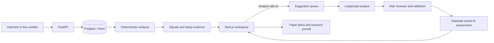

# QuantRift

**See the setup. Understand the why.**

QuantRift is an open-source research workspace for following markets, reviewing trade setups, and getting a second perspective from AI. Keep your charts, supporting evidence, conditional paper setups, and research notes together.

[Open QuantRift](https://quantrift.vercel.app) · [Get started locally](#get-started-locally) · [Enable AI research](docs/trade-suggestions.md) · [Deployment guide](docs/deployment.md)

## A clearer research routine

1. **Follow your markets.** Build a watchlist and connect or import candle data.
2. **Find a setup.** Run a scan and review a focused list of ideas, with direction, data freshness, and a reason to look closer.
3. **Understand the chart.** Inspect closed candles, market structure, supporting evidence, and invalidation conditions.
4. **Ask for another perspective.** Request an AI assessment and compare the analyst’s proposal with an independent risk review.
5. **Keep the thinking.** Save a paper plan or journal note, then revisit the observed outcome.

You make the final decision. QuantRift does not connect to brokers for order execution or place trades.

## Inside the workspace

| Page | What you do |
| --- | --- |
| **Overview** | See priority setups, ideas waiting for confirmation, data needing attention, and research follow-ups. |
| **Markets** | Follow your watchlists and open the latest available setup for a symbol. |
| **Setups** | Search and filter a responsive setup list, then open a chart to review the evidence. |
| **Scanner** | Run a saved scan and read its results. Expand watchlists and settings when you need to change them. |
| **Journal** | Write observations, link them to setups, and revisit your previous thinking. |

Daily briefs, paper plans, outcome reviews, equity research, data management, preferences, and account tools remain available under **Research & tools**. Secondary configuration and diagnostics sit behind expandable sections so the main workflow stays readable.

The homepage includes an interactive preview with clearly labeled illustrative data. Its prices and assessments are examples, not live market quotes.

## Your account

Sign in and create an account through a focused, responsive interface adapted from HVACLine. New accounts verify their email before signing in. Existing accounts and workspaces are preserved. Optional authenticator-app verification adds an enrollment QR code and single-use recovery codes.

Authenticator verification defaults off. This release requires the new auth migration even when it stays off. See the [account setup and rollout guide](apps/api/docs/auth.md#authenticator-verification) for dependencies, encryption-key configuration, and activation.

## AI research with a second review

An optional LangGraph workflow uses OpenAI to assess the latest stored closed candles:

- The **analyst** proposes a conditional **BUY**, **SELL**, or **WAIT** idea and explains its evidence.
- The **risk reviewer** challenges the idea, its levels, and contradictory context.
- Code validates prices, evidence references, and a minimum **2:1 reward-to-risk** at the least favorable entry price.
- The chart shows the proposed entry zone, stop, and targets. Saved results retain their data cutoff and become outdated as fresh candles arrive.

BUY means a proposed long setup; SELL means a proposed short setup. WAIT contains no trade levels. AI assessments are stored separately from deterministic signals and cannot rewrite them.

AI research is **disabled by default**. It needs a server-side OpenAI API key, the suggestion migration, and a running suggestion worker. The default model is configurable. See the [complete configuration and operating guide](docs/trade-suggestions.md).

## Get started locally

### Start the application

Clone the repository:

```sh
git clone https://github.com/waqasraza123/quantrift.git
cd quantrift
```

Start the development stack:

```sh
make dev
```

In another terminal, apply migrations and seed the defaults:

```sh
make migrate
make seed
```

Open the homepage at **http://127.0.0.1:3000** and the workspace at **http://127.0.0.1:3000/command-center**. API documentation is available at **http://127.0.0.1:8000/docs**.

The local stack defaults to developer authentication. For registration, verified email, and session-based accounts, follow the [authentication and deployment instructions](docs/deployment.md).

If you prefer running services without Docker:

```sh
./scripts/dev-api.sh
./scripts/dev-web.sh
```

See the [development guide](docs/development.md) for database setup, environment configuration, and the existing verification commands.

### Enable the AI assessment

Add your key and enable the feature in the ignored `apps/api/.env` file, or your deployment’s secret manager:

```dotenv
OPENAI_API_KEY=your-server-side-key
TRADE_SUGGESTIONS_ENABLED=true
TRADE_SUGGESTIONS_MODEL=gpt-6.1-sol
TRADE_SUGGESTIONS_REASONING_EFFORT=medium
```

Apply the schema and start the dedicated worker from `apps/api`:

```sh
uv run alembic upgrade head
uv run python -m app.workers.job_queue_worker --queue trade_suggestions --concurrency 2
```

For the local Compose stack, the worker service is:

```sh
docker compose --profile workers up -d trade-suggestion-worker
```

Restart the API after changing its environment. Open a setup chart and choose **Analyze with AI**. Keep the API and worker connected to the same database and configuration. Fresh candle data is required; opening a chart does not silently refresh a market-data provider.

The [AI research guide](docs/trade-suggestions.md) covers limits, permissions, expiry, queue behavior, and failure states.

## How it fits together



Python owns the API, data contracts, analysis, and agent workflows. Next.js provides the product interface. Postgres holds persisted research and sessions. Redis supports distributed rate limits where configured. An optional Go worker handles market-data ingestion.

| Directory | Contents |
| --- | --- |
| `apps/web` | Homepage, workspace, charts, account screens, and browser coverage |
| `apps/api` | FastAPI, auth/RBAC, market intelligence, LangGraph agents, migrations, and workers |
| `apps/go/market-worker` | Optional polling and streaming market-data worker |
| `docs` | Development, deployment, architecture, and operating guides |

## Deployment and accounts

QuantRift supports first-party session authentication backed by Postgres/Neon, workspace permissions, verified-email registration, password rotation, session revocation, and account activity.

For production:

- Configure the database, auth mode, email delivery, and the API/web origins.
- Keep database credentials and provider keys on the server; never use `NEXT_PUBLIC_*` for secrets.
- Use a direct Neon connection for Alembic migrations and the appropriate pooled connection for application traffic.
- Run migrations before serving the new application and start only the workers your deployment needs.

Use the [deployment guide](docs/deployment.md) and [API README](apps/api/README.md) for the full configuration.

## Research boundaries

QuantRift provides market context and conditional paper setups for human review. It does not provide a broker, autonomous execution, leverage or account-sizing instructions, or guaranteed outcomes. Data quality checks and agent reviews do not establish prediction accuracy.

The deterministic signal, AI assessment, and your journal notes are distinct records. A saved idea can become outdated. Check the data timestamp and the conditions that would invalidate it.

## Contributing

Follow the repository’s [agent instructions](AGENTS.md), [development guide](docs/development.md), and [project state](docs/project-state.md). Preserve the separation between deterministic analysis, AI proposals, and human decisions.

Licensed under the [MIT License](LICENSE).
