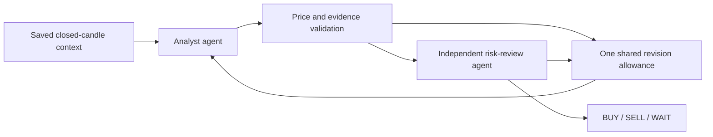

# LangGraph trade suggestions

Signal detail pages include an optional **Analyze with AI** panel. The existing deterministic
signal chart remains available. The AI panel uses a separate saved window of the latest stored
closed candles, so a historical signal is not presented as a current recommendation.

BUY describes a conditional long setup, SELL a conditional short setup, and WAIT an assessment
without qualifying trade levels. Suggestions are paper setups for human review. They do not
place orders, modify deterministic signals, manage holdings, or use account balances.

## Enable the feature

Install the API dependencies using the existing Python environment:

```sh
cd apps/api
uv pip install -e '.[dev]'
```

Configure the following values in the ignored API environment file or your deployment's secret
manager. API and worker processes must receive the same configuration and database connection:

```dotenv
OPENAI_API_KEY=your-server-side-key
TRADE_SUGGESTIONS_ENABLED=true
TRADE_SUGGESTIONS_MODEL=gpt-6.1-sol
TRADE_SUGGESTIONS_REASONING_EFFORT=medium
```

Keep the key out of web environment variables, source control, logs, and browser requests.
`OPENAI_BASE_URL` is optional and must support the OpenAI Responses API and strict structured
outputs. Existing explanation/scenario provider settings do not enable or control this feature.

Apply the migration before enabling traffic:

```sh
cd apps/api
uv run alembic upgrade head
```

The new revision is `202610311200_trade_suggestions`, following
`202610221000_auth_trade_agent_merge`. For production Neon migration connection requirements,
follow the existing deployment guide.

Start the dedicated queue worker alongside the API:

```sh
cd apps/api
uv run python -m app.workers.job_queue_worker --queue trade_suggestions --concurrency 2
```

For the local Docker Compose stack:

```sh
docker compose --profile workers up -d trade-suggestion-worker
```

This service runs the actual job-queue runtime; it is separate from the existing worker supervisor
service. API startup does not start a worker. A missing worker produces an expiring queued run,
not an indefinite generation request. Dependency installation and configuration changes require
restarting the relevant services.

## Workflow and contracts

The typed LangGraph workflow is:



There is one revision allowance across validation and risk review, with at most four OpenAI calls.
The reviewer can veto a direction and produce WAIT. Repeated invalid output, refusals, provider
errors, and timeouts produce blocked/failed runs rather than invented WAIT decisions.

Both roles use the Responses API through `langchain-openai`, strict Pydantic output schemas,
no SDK retries, and `store=false`. The app stores the bounded candle snapshot, configuration,
validated proposal, risk-review summary, model/prompt versions, usage counters, and latency in
`trade_suggestion_runs`. It does not persist provider payloads or internal reasoning traces.
LangSmith and a separate LangGraph hosting service are not required.

| Endpoint | Behavior |
| --- | --- |
| `GET /trade-agent/suggestions/availability` | Reports feature/key availability without exposing secrets |
| `POST /trade-agent/suggestions/from-signal/{signal_id}` | Returns HTTP 202 with a saved or queued run |
| `GET /trade-agent/suggestions/{suggestion_id}` | Reads status, saved context, validated result, expiry, and usability |
| `GET /trade-agent/suggestions?workspaceId=…&signalId=…&limit=10` | Reads the latest saved runs, maximum 50 |

Creation accepts `{ "requestId": "<uuid>", "regenerate": false }`. Reuse the request UUID when
retrying a transport failure. Repeated requests reuse the in-flight run; an identical completed
snapshot can be reused unless `regenerate` is true. Regeneration uses a new UUID and retains
earlier runs. Every request resolves the actual record's workspace and checks analysis permissions.
Creation requires `analysis.write`; reads require `analysis.read`.

Statuses are `queued`, `running`, `completed`, `blocked`, and `failed`. Only completed runs have
a BUY/SELL/WAIT result. `stage` identifies context, analyst, validation, or risk-review progress.
`isOutdated` becomes true at the freshness deadline or when a newer final candle appears;
`actionable` is false for WAIT, outdated results, and unavailable configuration. This flag is a
display eligibility check, not permission to execute orders.

## Data and risk rules

- Context is limited to one workspace, symbol, source, and timeframe. If the original analysis
  lacks a source, exactly one compatible source must exist. Partial and not-yet-closed candles
  are excluded.
- At least 20 candles are required; at most 200 are supplied. Features and indicators are calculated
  using existing pure calculators. The original signal is explicitly dated historical context;
  future outcomes, private journal notes, and credentials are excluded.
- Freshness follows existing market-memory timeframe settings. Missing data, low candle quality,
  excessive gaps, inactive sources, and inactive symbols block generation before provider calls.
  Quality checks use UTC interval coverage; exchange-session calendars are not inferred. Market
  closures can therefore make sparse windows ineligible.
- BUY requires `stop < entryLower <= entryUpper < target1`; SELL requires
  `target1 < entryLower <= entryUpper < stop`. Further targets must extend in the same direction.
  All levels must be positive and finite. Decimal arithmetic calculates the first target's
  reward/risk at the least favorable entry bound, requiring at least 2:1.
- Evidence references must belong to the saved context. The reviewer checks whether the proposed
  levels and claims are supported. These checks do not establish prediction accuracy.
- The saved chart labels AI entry, stop, targets, and direction separately. Outdated suggestions
  retain their history but hide active overlays. WAIT has no trade-level overlays.

## Limits and operations

`apps/api/.env.example` lists all `TRADE_SUGGESTIONS_*` settings. Defaults are disabled, ten new
runs per workspace per rolling hour, a 300-second queue deadline, a 180-second graph deadline,
a 60-second model request timeout, and 8,192 output tokens per call. The minimum reward/risk
setting cannot be below 2. Candle quality defaults to 0.80.

Submission uses a PostgreSQL workspace lock to serialize duplicate and quota checks. Queue jobs
contain only the suggestion ID and use one attempt. The dedicated queue claims no more work than
its concurrency, renews leases while agents run, and cancels generation if its heartbeat fails.
Reads reconcile interrupted/deadline-exceeded runs and release their queue records. A failed run
requires a new explicit generation request; whole graphs are not retried automatically.

Monitor the `trade_suggestions` queue, run status/error codes, `stage`, `usageJson`, and
`completedAt`. Operational failures expose sanitized messages without raw OpenAI responses.
Disable `TRADE_SUGGESTIONS_ENABLED` on both API and workers to stop new generation. Saved history
remains readable.

## Verification handoff

No tests, builds, lint, type checks, migration execution, or live OpenAI calls were run for this
implementation, as requested. Before enabling production, verify the migration in a disposable
database, ownership/RBAC, concurrent submission limits, queue interruption/deadlines, malformed
provider output, reviewer veto/revision paths, BUY/SELL geometry and exact 2:1 boundaries,
freshness changes, saved history, and browser overlays. Test with mocked model responses first.
